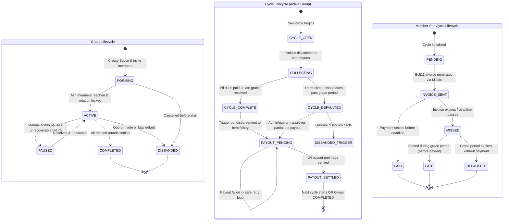

# Sats Sacco — Lifecycle State Machine & Architectural Specification

Sats Sacco digitizes traditional Rotating Savings and Credit Associations (ROSCAs / Chamas / Susus / Tandas) over Bitcoin Lightning and Nostr. 
This document defines the formal multi-tier state machine, edge-case resolution rules, threat model, and core architectural decisions for review and approval prior to implementation.

---

## 1. Multi-Tier State Machine Architecture

The system operates across three coupled lifecycle layers:
1. **Group Level**: Overall ROSCA lifecycle from member registration to final circle completion or disbandment.
2. **Cycle Level**: Per-round collection and settlement progression.
3. **Member-Per-Cycle Level**: Individual contribution tracking for a specific cycle.

---

## 2. Detailed State Definitions & Transitions

### 2.1 Group States
- **`FORMING`**: Sacco parameters configured (contribution amount in sats, cycle interval, max members). Members join via Telegram invite link and submit/derive their Nostr pubkey and payout LN address/invoice.
- **`ACTIVE`**: Rotation order is deterministically set and locked. Cycles run in sequential order ($1 \dots N$).
- **`PAUSED`**: System operations paused (e.g. LNbits node maintenance or group dispute). Contribution timers paused.
- **`COMPLETED`**: Every member has completed their payout round and contributed to all cycles. Reputation events published to Nostr.
- **`DISBANDED`**: Circle dissolved early. Unspent funds refunded or settled according to group agreement.

### 2.2 Per-Cycle States
- **`CYCLE_OPEN`**: Current cycle round initialized. Pot recipient designated by rotation index.
- **`COLLECTING`**: LNbits invoices generated and sent to all contributing members via Telegram.
- **`CYCLE_COMPLETE`**: 100% of required contributions collected and verified.
- **`CYCLE_DEFAULTED`**: One or more members missed payment past the deadline. AI flags anomaly and notifies group.
- **`PAYOUT_PENDING`**: Pot disbursement initiated to the beneficiary's Lightning Address or Bolt11 invoice.
- **`PAYOUT_SETTLED`**: Payout preimage confirmed. Signed Nostr receipt (NIP-78/custom kind) broadcast.

### 2.3 Per-Member-Per-Cycle States
- **`PENDING`**: Member queued for the upcoming cycle round.
- **`INVOICE_SENT`**: Member received customized LNbits Bolt11 invoice with explicit expiry.
- **`PAID`**: Invoice settled on-chain/Lightning before cycle deadline.
- **`MISSED`**: Invoice expired without payment. AI reminder dispatched.
- **`LATE`**: Paid after deadline, but before the pot payout execution was sent. Configurable penalty fee / reputation tag applied.
- **`DEFAULTED`**: Member failed to pay even within the late grace period.

---

## 3. Explicit Edge Cases & Recovery Protocols

### 1. Invoice Expiry Before Payment (`MISSED`)
- **Handling**: Webhook/poller detects invoice expiration. State shifts to `MISSED`. 
- **Action**: Member is **not** dropped from group totals. AI assistant generates an empathetic, context-aware payment reminder in plain language via Telegram with a 1-click button to request a fresh invoice.

### 2. Timely Full Settlement (`CYCLE_COMPLETE` $\to$ `PAYOUT_SETTLED`)
- **Handling**: The moment the last contributor's invoice settles before deadline, transition immediately to `CYCLE_COMPLETE` $\to$ `PAYOUT_PENDING`.
- **Action**: Autonomous trigger attempts payout to beneficiary's LN wallet. On receipt of valid 32-byte preimage, shifts to `PAYOUT_SETTLED` and broadcasts cryptographic Nostr settlement event.

### 3. Late Payment Before Payout Sent (`LATE`)
- **Configurable Policy**: If a member pays after deadline while cycle is still in `COLLECTING` (grace window) or before payout lock:
  - Marked `LATE` in database.
  - Contribution is credited towards the cycle pot.
  - Event logged in Nostr portable reputation as `"LATE"` (does not destroy reputation, but differentiates from flawless on-time cycles).

### 4. Payout Recipient LNbits Wallet / Invoice Fails on Payout
- **Double-Payment Prevention**:
  - Atomic lock (`payout_in_progress = true` + unique idempotency payment key).
  - Check transaction state in LNbits prior to retrying. Never initiate a new payout unless the prior attempt returned a terminal `failed` status without sat deduction.
- **Group Transparency**: State moves to `PAYOUT_FAILED_RETRYING`. Bot posts a clear notice: *"Payout attempt to @recipient failed (routing error / offline wallet). Retrying in 15 minutes. No funds were lost."*

### 5. Rogue Member Tries to Leave Mid-Cycle (Post-Payout Default)
- **Problem**: Member receives the pot in Cycle 1, then refuses to pay in Cycles 2..N.
- **Handling**:
  - Circle agreement rule: Members cannot leave an `ACTIVE` circle without unanimous admin intervention.
  - If member defaults, marked as `DEFAULTED_DEFECTOR`.
  - An immutable verifiable Nostr reputation event is published referencing their pubkey: `defaulted: true, cycle: 2, amount: X sats`.
  - Pubkey and Telegram ID permanently blacklisted from creating or joining future Sats Sacco groups on the platform.

### 6. Rotation Collision / Data Race in Payout Order
- **Guaranteed Invariant**:
  - Rotation order is computed at the moment of group activation (`FORMING` $\to$ `ACTIVE`).
  - Generated either via:
    a) Seeded cryptographic shuffle (e.g., hash of block height at activation + concatenated member pubkeys), or
    b) Transparent pre-agreed member order confirmed by group leader.
  - Order is stored as a strictly indexed SQLite array: `rotation_index INT UNIQUE (0..N-1)` with unique constraint.
  - Two members having the same turn is mathematically and relationally impossible.

---

## 4. Threat Model & Security Architecture

1. **Telegram User ID & PII Privacy**:
   - Zero raw Telegram user IDs in application logs.
   - User IDs are hashed with a server secret salt before writing to log streams: `log(user_hash: SHA256(tg_id + SALT)[:12])`.
   - Member identity in public Nostr events is strictly tied to their chosen Nostr pubkey, never Telegram metadata.

2. **Non-Custodial / Minimal Custody Design**:
   - The bot coordinator maintains an operational routing wallet on LNbits purely as an automated transit hub.
   - Sats do not sit long-term in the bot: pot is paid out immediately when collected.
   - Payouts are made directly to the recipient's LNbits wallet or Lightning Address (`lnurlp`).

3. **Compromised Telegram Account**:
   - Payout destinations are registered and locked at group formation.
   - Changing a payout Lightning address requires confirmation or group admin approval to prevent compromised Telegram accounts from hijacking pot payouts.

4. **LNbits Downtime Mid-Cycle**:
   - State and pending invoices are persisted durably in SQLite.
   - If LNbits is offline, the poller backs off with exponential jitter. Once LNbits recovers, all invoices are checked and reconciled without data loss.

5. **Input Sanitization**:
   - Strict validation on satoshi amounts (must be positive integer, within group limit).
   - Sanitization of Telegram message text and Nostr event JSON to prevent injection attacks.

---

## 5. Architectural Proposals for Approval

1. **Bot Framework**:
   - **Recommendation**: **`grammY`** (modern, robust TypeScript Telegram bot framework with first-class async middleware, inline keyboards, and session handlers).
2. **Lightning Backend**:
   - **Recommendation**: **LNbits API** (supports self-hosted Docker and real public demo/test instances like `legend.lnbits.com`, simple REST endpoints for invoices, webhooks, and payments).
3. **Nostr Client**:
   - **Recommendation**: **`nostr-tools`** (v2) with multi-relay connection to real public relays (`wss://relay.damus.io`, `wss://nos.lol`, `wss://relay.primal.net`).
4. **AI Assistant Integration**:
   - **Recommendation**: **OpenAI API / Gemini API** (via standard REST / official SDK) using structured prompt templates for reminders, summaries, and anomaly detection.
5. **Dashboard & Tech Stack**:
   - **Backend**: Node.js / TypeScript + SQLite (`better-sqlite3` or `sqlite3`) for ACID durability.
   - **Dashboard**: Vite + React + TailwindCSS (bespoke high-contrast terracotta & amber palette, circular rotation visualizer, WCAG AA compliant).
   - **Monorepo**: Clean directory structure (`apps/bot`, `apps/dashboard`, `packages/core`).
